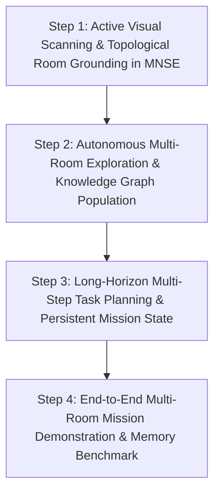

# Phase 5 Implementation Plan
## Autonomous Multi-Room Exploration & Long-Horizon Task Execution

---

### 1. Executive Summary

With the successful completion and verification of **Phase 4 Step 4** ("Navigation-Grounded Object Interaction"), GRaCEmo ViRa has established a validated foundation for embodied perception, 3D world persistence in the Rust MNSE Kernel, and object-grounded locomotion within a local room. The robot can perceive an object using YOLO11n and metric depth, persist its identity in SQLite, reason over its mechanical neck limits ($\pm 120^\circ$), execute in-place base turns, safe-stop, re-observe, and perform verified LookAt gazes.

However, the robot remains fundamentally **room-bound and reactive**. If a target object is located in another room (e.g. Master Bedroom, Home Study, Living Room) or has not yet been sighted, the system cannot autonomously explore, map the apartment, sequence multi-room navigation, or maintain persistent mission progress across extended horizons.

This implementation plan defines **Phase 5: Autonomous Multi-Room Exploration & Long-Horizon Task Execution** (fulfilling the roadmap milestone defined in `docs/architecture/ROADMAP_PHASES.md`). Phase 5 elevates GRaCEmo from single-room reactive gazing into an autonomous, long-horizon service humanoid capable of systematically exploring the 4-room apartment, populating the Rust MNSE Knowledge Graph with complete room-object topological relationships, executing multi-step mission sequences across doorways, recovering from missing targets, and answering grounded spatial memory queries from compiled TOON context.

---

### 2. Current System Audit

A thorough inspection of all repository directories (`kernel/`, `adapters/`, `ros2_ws/`, `scripts/`, `tests/`, `docs/`) reveals the following architectural state:

```
┌──────────────────────────────────────────────────────────────────────────────────────────┐
│                                 GRaCEmo ViRa System Audit                                │
├──────────────────────────┬─────────────────────────────────────┬─────────────────────────┤
│ Component                │ Implementation Path                 │ Operational Status      │
├──────────────────────────┼─────────────────────────────────────┼─────────────────────────┤
│ Rust MNSE Kernel         │ kernel/gracemo-kernel/              │ Authoritative / Active  │
│ Canonical Types          │ kernel/gracemo-types/               │ Synchronized / Active   │
│ K Operational DSL        │ kernel/gracemo-k/, bin/k            │ Active Runtime          │
│ SQLite WAL Graph Store   │ kernel/gracemo-kernel/src/graph.rs  │ Authoritative / Active  │
│ Append-Only Event Ledger │ kernel/gracemo-kernel/src/ledger.rs │ Active SQLite WAL       │
│ TOON Context Compiler    │ kernel/src/context_compiler.rs      │ Active / Real-time      │
│ Perception Service       │ adapters/perception/                │ Active YOLO11n + Depth  │
│ Gemini Robotics ER 2     │ adapters/gemini_robotics/           │ Live API / AFC Active   │
│ Tool Registry            │ adapters/gemini_robotics/tools.py   │ Active High-Level Tools │
│ Kernel ROS 2 Bridge      │ ros2_ws/src/gracemo_bridge/         │ Active Bridge           │
│ Sensor Bridge            │ ros2_ws/src/gracemo_bridge/         │ Active (RGB, Depth, TF) │
│ Gazebo Simulation        │ ros2_ws/src/gracemo_gazebo/         │ Harmonic Physics Active │
│ Robot URDF Model         │ ros2_ws/src/gracemo_description/    │ Full Articulated Vira   │
│ Active 2-DOF Neck        │ neck_pan_joint, neck_tilt_joint     │ Kinematically Governed  │
│ Mobile Base Controller   │ Differential Drive / cmd_vel        │ Kinematically Governed  │
│ 6-DOF Right Arm          │ adapters/motion/arm_controller.py   │ Standalone Stances Only │
│ 2-Finger Gripper         │ adapters/motion/hand_controller.py  │ Standalone Physics Only │
│ Mission Planner          │ adapters/brain/mission_planner.py   │ Standalone Script Only  │
│ Face Recognition         │ adapters/vision/gracemo_vision/     │ Standalone Stub Only    │
│ Voice STT / TTS          │ adapters/voice/gracemo_voice/       │ Standalone Modules Only │
└──────────────────────────┴─────────────────────────────────────┴─────────────────────────┘
```

---

### 3. Existing Capabilities Audit

Every capability specified in the discovery mandate was audited against actual source code and executed test suites:

| # | Capability | Audit Status | Code Location & Evidence |
| :---: | :--- | :--- | :--- |
| **1** | **Object detection** | **IMPLEMENTED** | `adapters/perception/detector.py` (YOLO11n RGB 640x480; live detections verified in Gazebo) |
| **2** | **Object persistence** | **IMPLEMENTED** | `kernel/gracemo-kernel/src/graph.rs` (`WorldObject` table, SQLite WAL, EMA smoothing, observation count) |
| **3** | **Object grounding** | **IMPLEMENTED** | `adapters/gemini_robotics/context.py` (`resolve_object()` validates finite 3D coordinates and status) |
| **4** | **Object identification** | **IMPLEMENTED** | `graph.rs` (deterministic sequential IDs `chair_001`, `table_001`, `bed_001`) |
| **5** | **Object tracking** | **IMPLEMENTED** | `graph.rs` (3D spatial Euclidean association $\le 0.5\text{m}$, ambiguity gate $\le 0.01\text{m}$) |
| **6** | **Re-identification** | **PARTIALLY IMPLEMENTED** | Metric spatial 3D Re-ID across camera re-observations implemented; visual appearance embedding vectors not implemented |
| **7** | **Face recognition** | **EXPERIMENTAL / STUB** | `adapters/vision/gracemo_vision/face_id.py` (YuNet wrapper exists; not connected to MNSE or Gemini) |
| **8** | **Voice input (STT)** | **PARTIALLY IMPLEMENTED** | `adapters/voice/gracemo_voice/stt.py` (Faster-Whisper + Silero VAD exists offline; not wired to live closed loop) |
| **9** | **Voice output (TTS)** | **PARTIALLY IMPLEMENTED** | `adapters/voice/gracemo_voice/tts.py` (Edge-TTS exists; `RobotAction::Speak` exists but is a `pass` in `kernel_bridge.py`) |
| **10** | **Gemini ER 2** | **IMPLEMENTED** | `adapters/gemini_robotics/client.py` (Live `gemini-robotics-er-2-preview` API & AFC orchestrator) |
| **11** | **LookAt** | **IMPLEMENTED** | 2-DOF active neck position control via `execute_look_at` in `kernel_bridge.py`; tested live |
| **12** | **TurnTo** | **IMPLEMENTED** | Canonical `RobotAction::TurnTo` via `_rotate_to_yaw` in `kernel_bridge.py`; tested live |
| **13** | **NavigateTo** | **IMPLEMENTED** | Canonical `RobotAction::NavigateTo` & topological `NavigateToRoom` in `kernel_bridge.py`; tested live |
| **14** | **Obstacle avoidance** | **IMPLEMENTED** | 2D LiDAR obstacle inflation cushion in `kernel_bridge.py` and `navigation_skill.py` |
| **15** | **Collision handling** | **IMPLEMENTED** | 360° tactile bumper contact sensor, emergency stop in `kernel_bridge.py`; tested in `test_collision_and_bumper.py` |
| **16** | **Arm control** | **PARTIALLY IMPLEMENTED** | URDF has 6-DOF right arm, Gazebo has 7 position controllers, `arm_controller.py` has stances; NOT connected to MNSE `ActionRequested` or `kernel_bridge.py` |
| **17** | **Hand/gripper control**| **PARTIALLY IMPLEMENTED** | URDF parallel jaw gripper, silicone pads, contact sensors, `hand_controller.py` verified; NOT connected to MNSE `ActionRequested` or `kernel_bridge.py` |
| **18** | **Manipulation** | **PARTIALLY IMPLEMENTED** | `manipulation_skill.py` exists in standalone mock/script; isolated from live perception and MNSE |
| **19** | **Pick** | **EXPERIMENTAL / STUB** | `pick_object` in `tools.py` uses mock fallback; no canonical Kernel event or dynamic 3D grounding |
| **20** | **Place** | **EXPERIMENTAL / STUB** | `place_object` in `tools.py` uses mock fallback; no canonical Kernel event |
| **21** | **Follow** | **NOT IMPLEMENTED** | No follow controller or target-following loop exists |
| **22** | **Person tracking** | **STUB / NOT IMPLEMENTED** | YOLO detects 'person' class, but no dedicated tracking or interaction active |
| **23** | **Multi-object reasoning**| **PARTIALLY IMPLEMENTED** | MNSE stores multiple objects, but Gemini ER 2 executes single-object goals |
| **24** | **Long-horizon task planning**| **EXPERIMENTAL / PARTIALLY IMPLEMENTED** | `mission_planner.py` defines `MissionPlan`/`MissionStep`; not integrated into Gemini ER 2 or orchestrator |
| **25** | **Task memory** | **PARTIALLY IMPLEMENTED** | Raw event ledger in SQLite; high-level mission/task state not persisted or exposed in TOON context |
| **26** | **Persistent task state**| **PARTIALLY IMPLEMENTED** | `InspectorState` tracks robot pose/room; no task execution state machine in MNSE |
| **27** | **Recovery** | **PARTIALLY IMPLEMENTED** | Low-level motor timeouts and bumper stops; no semantic plan recovery |
| **28** | **Human interaction** | **PARTIALLY IMPLEMENTED** | Text prompt commands in `run_task()`; voice/face offline |
| **29** | **Web command center** | **NOT IMPLEMENTED** | No web UI or dashboard in repo |
| **30** | **Mission planning** | **PARTIALLY IMPLEMENTED / EXPERIMENTAL** | `mission_planner.py` spatial topological graph and waypoint sequences exist offline |

---

### 4. Missing Capabilities & Architectural Gaps

While low-level locomotion (`TurnTo`, `NavigateTo`) and single-object gaze (`LookAt`) are solid, the robot cannot yet perform autonomous multi-step missions across the apartment. Specifically:

1. **Lack of Active Visual Scanning**:
   - The robot has an active 2-DOF neck, but when it arrives in a room, it only processes a static forward frame. It cannot sweep its neck across the room to discover objects out of its immediate forward cone.
2. **Disconnected Room-Object Knowledge**:
   - In `graph.rs`, seeded rooms (`room:bedroom`, `room:kitchen`, etc.) and doorway portals exist, but the robot has never visited the other rooms. Objects in the Master Bedroom (`bed`, `wardrobe`, `nightstand`), Home Study (`desk`, `bookshelf`), and Living Room (`sofa`, `couch`, `tv`) are completely unmapped in MNSE.
3. **No Autonomous Multi-Room Exploration Policy**:
   - The robot cannot systematically visit all rooms to build an authoritative environmental catalog.
4. **No Long-Horizon Multi-Step Task Execution**:
   - Gemini ER 2 is currently restricted to single-turn reactive prompts (`"Look at the chair."`). If asked `"Find the bed in the apartment and look at it"`, Gemini has no tool to plan a multi-room transit, verify arrival, execute a scan, and complete the goal.
5. **Lack of Persistent Task State in Rust MNSE**:
   - If a multi-step task is being executed, MNSE has no concept of active subgoals, step progress, or mission completion. All task state resides transiently in the Python orchestrator memory.
6. **No Semantic Plan Recovery**:
   - If a target object is missing from the expected room, the system halts rather than querying adjacent rooms or falling back to a systematic search.

---

### 5. Architectural Milestone Comparison

To determine the logical next milestone, the principal candidates were compared factually:

```
┌────────────────────────────────────────────────────────────────────────────────────────────────────────┐
│                                   Milestone Candidate Evaluation                                       │
├─────────────────────┬───────────────────────────────┬───────────────────────────────┬──────────────────┤
│ Dimension           │ Candidate A: Manipulation     │ Candidate B: Exploration &    │ Candidate C:     │
│                     │ & Object Grasping (Pick/Place)│ Long-Horizon Task Execution   │ Voice & Face ID  │
├─────────────────────┼───────────────────────────────┼───────────────────────────────┼──────────────────┤
│ Current             │ Base navigation waypoint error│ 4-room apartment simulation,  │ Audio engines and│
│ Prerequisites       │ is ~0.30m. Grasping requires  │ topological doorways, LiDAR,  │ YuNet CNN models │
│                     │ <0.05m base precision or fine │ YOLO11n, 2-DOF neck, and base │ exist as offline │
│                     │ visual servoing.              │ navigation are all working.   │ Python scripts.  │
├─────────────────────┼───────────────────────────────┼───────────────────────────────┼──────────────────┤
│ Existing Code       │ `arm_controller.py` has 7-DOF │ `kernel_bridge.py` has room   │ `stt.py` &       │
│                     │ stances. DetachableJoint in   │ waypoints; `graph.rs` has room│ `tts.py` exist;  │
│                     │ Gazebo is commented out.      │ nodes and doorway portals.    │ Gazebo has no    │
│                     │                               │                               │ audio physics.   │
├─────────────────────┼───────────────────────────────┼───────────────────────────────┼──────────────────┤
│ Missing Components  │ Arm/hand actions in Kernel,   │ Active visual scanning skill, │ Host audio bridge│
│                     │ contact dynamics tuning,      │ persistent mission state in   │ to ROS 2, face   │
│                     │ dynamic attachment plugin, IK.│ MNSE, multi-step planner.     │ embeddings, actor│
├─────────────────────┼───────────────────────────────┼───────────────────────────────┼──────────────────┤
│ Technical Risk      │ High: ODE physics instability │ Low-Medium: Navigation through│ Low: Audio driver│
│                     │ and gripper slip in Gazebo.   │ doorways is proven in tests.  │ quirks in docker │
├─────────────────────┼───────────────────────────────┼───────────────────────────────┼──────────────────┤
│ Validation          │ High: Requires delicate fine  │ High Confidence: Fully test-  │ Difficult: Sim   │
│ Feasibility         │ contact simulation in Gazebo. │ able in existing Gazebo world.│ has no humans.   │
├─────────────────────┼───────────────────────────────┼───────────────────────────────┼──────────────────┤
│ Architectural       │ High, but premature without   │ Critical: Directly fulfills   │ Low: Peripheral  │
│ Impact              │ precise mobile base docking.  │ Roadmap Phase 5 mandate.      │ I/O interface.   │
└─────────────────────┴───────────────────────────────┴───────────────────────────────┴──────────────────┘
```

**Conclusion**: **Candidate B ("Autonomous Multi-Room Exploration & Long-Horizon Task Execution")** is the logical next architectural milestone. It directly builds upon the validated mobile base locomotion and 3D perception from Phase 4, fulfills the original roadmap mandate in `docs/architecture/ROADMAP_PHASES.md` ("Closed-Loop Awareness & Grounded Reasoning"), and establishes the spatial awareness and precise multi-room navigation that physical manipulation will require in Phase 6.

---

### 6. Proposed Phase 5 Objective

**PHASE 5 — AUTONOMOUS MULTI-ROOM EXPLORATION & LONG-HORIZON TASK EXECUTION**

> **Objective**: Extend the authoritative Rust MNSE Kernel, persistent 3D world model, and Gemini Robotics ER 2 closed loop into a fully autonomous, long-horizon multi-room exploration and mission execution system. The robot will autonomously navigate between apartment rooms, execute active visual sweeps with its 2-DOF neck, populate the Rust MNSE Knowledge Graph with complete room-object topological relationships, maintain persistent mission state in SQLite, execute multi-step natural language goals across the entire apartment, recover from missing objects, and answer grounded spatial memory questions.

---

### 7. Phase 5 Architecture Diagram

```
                              [ Natural Language Command ]
                 "Search the apartment for the desk, and when found, look at it."
                                           │
                                           ▼
┌────────────────────────────────────────────────────────────────────────────────────────┐
│                        Google Gemini Robotics ER 2 (Cognition)                         │
│  - Evaluates Authoritative Context: TOON context + persistent WORLD OBJECTS + ROOMS   │
│  - Formulates Multi-Step Plan: [Explore/Navigate -> Scan -> Resolve -> LookAt]         │
│  - Tracks active subgoals and recovery options across multi-turn reasoning passes       │
└───────────────────────────────────┬────────────────────────────────────────────────────┘
                                    │
                                    ▼ Tool Calls
┌────────────────────────────────────────────────────────────────────────────────────────┐
│                         ToolRegistry (adapters/gemini_robotics)                        │
│  - navigate_to_room(room)                                                              │
│  - scan_room(pan_min_deg, pan_max_deg, tilt_deg)                                       │
│  - explore_apartment(target_object=None)                                               │
│  - look_at_object(object_id)                                                           │
│  - get_room_objects(room_name)                                                         │
│  - emit_mission_event(action, status, step)                                            │
└───────────────────────────────────┬────────────────────────────────────────────────────┘
                                    │
                                    ▼ Canonical ActionRequested Events
┌────────────────────────────────────────────────────────────────────────────────────────┐
│                    Rust MNSE Kernel & EventBus (kernel/gracemo-kernel)                 │
│  - Canonical RobotAction: NavigateToRoom, ScanRoom, TurnTo, LookAt, MissionControl     │
│  - Persistent Mission State Store (tracks active mission_id, step, status in SQLite)   │
│  - Knowledge Graph Store:                                                              │
│      • Nodes: Room, Portal, WorldObject, Robot                                         │
│      • Edges: LOCATED_IN (Object -> Room), CONNECTS (Room -> Portal), LEADS_TO         │
│  - Real-Time TOON Context Compiler embedding apartment spatial map & active mission   │
└───────────────────────────────────┬────────────────────────────────────────────────────┘
                                    │
                                    ▼ Event Broadcast
┌────────────────────────────────────────────────────────────────────────────────────────┐
│                      ROS 2 Kernel Bridge (gracemo_bridge/kernel_bridge.py)             │
│  - Topological Doorway Navigation: Hallway <-> Kitchen, Bedroom, Study, Living Room    │
│  - Active 2-DOF Neck Sweep Controller: smooth sinusoidal/linear pan-tilt trajectory    │
│  - 360° Tactile Bumper & LiDAR Obstacle Safety Invariants                              │
└───────────────────────────────────┬────────────────────────────────────────────────────┘
                                    │
                                    ▼ Physical Actuation & Sensing
┌────────────────────────────────────────────────────────────────────────────────────────┐
│                      Gazebo Harmonic Physical Simulation (4-Room World)                │
│  - Base differential drive traverses corridors and doorways                           │
│  - 2-DOF neck executes active visual scan at room observation station                  │
│  - Camera RGB (640x480) + Depth (320x240) streams visual scene during scan            │
└───────────────────────────────────┬────────────────────────────────────────────────────┘
                                    │
                                    ▼ Visual Detections
┌────────────────────────────────────────────────────────────────────────────────────────┐
│                     Perception Foundation (adapters/perception)                        │
│  - YOLO11n detects furniture/objects throughout neck sweep trajectory                  │
│  - 3D Coordinate Transformer projects detections into world coordinates                │
│  - Emits ObjectDetected events tagged with current room provenance                     │
└───────────────────────────────────┬────────────────────────────────────────────────────┘
                                    │
                                    ▼ Association & Topological Edge Creation
┌────────────────────────────────────────────────────────────────────────────────────────┐
│                     Rust MNSE Spatial Association & Edge Creation                      │
│  - 3D Euclidean clustering associates detections into persistent WorldObject entities   │
│  - Adds LOCATED_IN edges linking WorldObject -> RoomNode in SQLite GraphStore          │
│  - Emits NavigationCompleted / ScanCompleted / StepCompleted to notify Orchestrator    │
└────────────────────────────────────────────────────────────────────────────────────────┘
```

---

### 8. Phase 5 Implementation Steps

Phase 5 is divided into 4 tightly scoped, sequentially testable steps:



---

#### Step 1: Active Visual Scanning & Topological Room Grounding in MNSE

- **Objective**: Implement active 2-DOF neck scanning while stationary in a room, capturing continuous multi-view detections and automatically linking detected objects to the active room node via `LOCATED_IN` edges in the Rust MNSE Kernel.
- **Files/Components**:
  - `kernel/gracemo-types/src/lib.rs`: Add canonical `RobotAction::ScanRoom { pan_range_deg: f64, tilt_deg: f64, speed_deg_s: f64 }`.
  - `ros2_ws/src/gracemo_bridge/gracemo_bridge/kernel_bridge.py`: Implement `_execute_scan_room` sweeping neck pan $[-60^\circ, +60^\circ]$ at tilt $+10^\circ$, halting base motion, and emitting `ScanCompleted`.
  - `adapters/perception/perception_service.py`: Support continuous scanning mode (accumulating detections across sweep).
  - `kernel/gracemo-kernel/src/graph.rs`: Automatically query current robot room and create `LOCATED_IN` edge between `WorldObject` and `RoomNode`.
- **Safety Invariants**:
  - Base must remain strictly stationary during scan ($v_x = 0.0, \omega = 0.0$, displacement $< 0.01\text{m}$).
  - Neck angles clamped to physical limits ($\pm 120^\circ$ pan, $\pm 45^\circ$ tilt).
- **Unit Tests**:
  - `tests/test_active_scan.py`: Test scan sweep generation, joint limit clamping, completion event emission.
  - Rust test in `graph.rs`: Test `LOCATED_IN` edge creation and querying objects by room.
- **Live Gazebo Validation**:
  - Robot positioned in Master Bedroom; commands `ScanRoom`; neck sweeps across room; detects `bed` and `nightstand`; MNSE records objects with `LOCATED_IN -> room:bedroom`.
- **Acceptance Gates**:
  - Gate 1.1: Base stationary during scan ($< 0.01\text{m}$ displacement, 0 `/cmd_vel`).
  - Gate 1.2: Neck sweeps smooth trajectory within $\pm 60^\circ$.
  - Gate 1.3: Multi-view detections aggregated into persistent `WorldObject` entries.
  - Gate 1.4: `LOCATED_IN` topological edges persisted in Rust SQLite.

---

#### Step 2: Autonomous Multi-Room Exploration & Knowledge Graph Population

- **Objective**: Implement an autonomous exploration routine that systematically navigates between all 4 apartment rooms via topological portals, performs visual scans, and populates the Rust MNSE Knowledge Graph with a comprehensive 3D object inventory of the entire apartment.
- **Files/Components**:
  - `adapters/gemini_robotics/tools.py`: Implement `explore_room(room_name)` and `explore_apartment()`.
  - `ros2_ws/src/gracemo_bridge/gracemo_bridge/kernel_bridge.py`: Verify corridor and doorway waypoint traversal for all 4 rooms:
    - Kitchen & Dining: $(-4.5, -2.5, \psi=-90^\circ)$
    - Master Bedroom: $(-5.0, 3.0, \psi=+90^\circ)$
    - Home Study: $(4.5, 3.0, \psi=+90^\circ)$
    - Living Room: $(4.0, -2.5, \psi=-90^\circ)$
    - Central Hallway: $(0.0, 0.0, \psi=0^\circ)$
  - `kernel/gracemo-kernel/src/api.rs`: Add `GET /world/rooms` and `GET /world/rooms/{room_id}/objects`.
  - `kernel/gracemo-kernel/src/context_compiler.rs`: Compile multi-room inventory into `#APARTMENT_MAP:` section in TOON context.
- **Safety Invariants**:
  - Collision-free doorway traversal (minimum clearance $> 0.20\text{m}$ from door jambs).
  - Tactile bumper watchdog halts navigation on unexpected contact.
- **Unit Tests**:
  - `tests/test_multi_room_navigation.py`: Waypoint calculations, corridor transitions, room queries.
- **Live Gazebo Validation**:
  - Autonomous exploration script executes: Hallway $\to$ Kitchen (scan) $\to$ Bedroom (scan) $\to$ Study (scan) $\to$ Living Room (scan) $\to$ Hallway.
  - Rust MNSE SQLite database inspected: contains $> 6$ unique furniture objects categorized across the 4 rooms.
- **Acceptance Gates**:
  - Gate 2.1: Autonomous traversal of all 4 rooms through doorway portals without collision.
  - Gate 2.2: Safe arrival and orientation at all room observation stations.
  - Gate 2.3: Multi-room Knowledge Graph fully populated in Rust SQLite.
  - Gate 2.4: Zero bumper collisions throughout full exploration tour.

---

#### Step 3: Long-Horizon Multi-Step Task Planning & Persistent Mission State

- **Objective**: Upgrade the Gemini ER 2 adapter and Rust MNSE Kernel to plan, execute, and track multi-step long-horizon missions across rooms, maintaining persistent mission state in SQLite and providing resilient recovery if target objects are not found.
- **Files/Components**:
  - `kernel/gracemo-types/src/lib.rs`: Define `MissionStatus`, `MissionStep`, and `EventType::MissionStateChanged`.
  - `kernel/gracemo-kernel/src/inspector_state.rs`: Add persistent `active_mission` tracking in `InspectorState`.
  - `adapters/gemini_robotics/orchestrator.py`: Upgrade orchestrator to maintain multi-turn subgoal tracking, step transitions, and goal verification.
  - `adapters/gemini_robotics/tools.py`: Expose high-level task tools (`start_mission`, `complete_step`, `report_mission_status`).
  - `adapters/gemini_robotics/context.py`: Embed active mission state and apartment room catalog into prompt.
- **Safety Invariants**:
  - Loop limit: Maximum 10 turns per mission to prevent infinite cognitive cycles.
  - Failure recovery: If an object is not found in the hypothesized room, plan transition to the next candidate room or conclude gracefully without hallucination.
- **Unit Tests**:
  - `tests/test_long_horizon_planning.py`: Multi-step plan decomposition, subgoal state transitions, failure recovery paths, mock reasoning cases.
- **Live Gazebo Validation**:
  - Command: `"Find the bed in the apartment and navigate to it."`
  - Gemini reasons that the bed is in Master Bedroom; dispatches `navigate_to_room("Master Bedroom")`; awaits arrival; dispatches `scan_room()`; resolves `bed_001`; dispatches `navigate_to_object("bed_001")`; safe-stops in front of bed.
- **Acceptance Gates**:
  - Gate 3.1: Gemini autonomously decomposes high-level intent into multi-step action sequence.
  - Gate 3.2: Persistent mission progress tracked in Rust MNSE SQLite.
  - Gate 3.3: Correct handling of missing objects with alternative search recovery.
  - Gate 3.4: Clean mission completion notification without runaway execution.

---

#### Step 4: End-to-End Multi-Room Mission Demonstration & Memory Benchmark

- **Objective**: Execute and validate full live closed-loop multi-room missions and spatial memory question answering against Gazebo Harmonic physics using the live Google Gemini ER 2 model.
- **Files/Components**:
  - `tests/test_phase5_live.py`: Comprehensive live test runner.
  - `scripts/run_phase5_live_test.sh`: Containerized Gazebo + ROS 2 + Rust Kernel simulation runner.
  - `PHASE_5_IMPLEMENTATION_REPORT.md`: Comprehensive final report.
- **Scenarios to Demonstrate**:
  - **Scenario A (Cross-Room Search & Gaze)**: Robot in Hallway; command: *"Find the desk in the study and look at it."* Navigates to study, scans, detects desk, turns, and gazes.
  - **Scenario B (Sequential Multi-Room Mission)**: Robot in Kitchen; command: *"Check the dining table, then go to the bedroom and inspect the bed."* Navigates to kitchen, gazes at table, transits to bedroom, gazes at bed.
  - **Scenario C (Spatial Memory Question Answering)**: User query: *"Which room has the refrigerator and what are its coordinates?"* Gemini queries MNSE TOON context and answers with verified facts without moving motors.
- **Acceptance Gates**:
  - All 15 Phase 5 Acceptance Gates evaluated and reported as **PASS**.

---

### 9. Files and Components Summary

```
┌────────────────────────────────────────────────────────────────────────────────────────┐
│                                 Files Modified / Created                                │
├──────────────────────────────────────────────────────┬──────────┬──────────────────────┤
│ File Path                                            │ Type     │ Purpose              │
├──────────────────────────────────────────────────────┼──────────┼──────────────────────┤
│ kernel/gracemo-types/src/lib.rs                      │ [MODIFY] │ Add ScanRoom action, │
│                                                      │          │ Mission events/types │
│ kernel/gracemo-kernel/src/graph.rs                   │ [MODIFY] │ LOCATED_IN edges,    │
│                                                      │          │ room query methods   │
│ kernel/gracemo-kernel/src/inspector_state.rs         │ [MODIFY] │ Persistent mission   │
│                                                      │          │ state tracking       │
│ kernel/gracemo-kernel/src/api.rs                     │ [MODIFY] │ Room-object endpoints│
│ kernel/gracemo-kernel/src/context_compiler.rs        │ [MODIFY] │ #APARTMENT_MAP: in   │
│                                                      │          │ compiled TOON context│
│ ros2_ws/src/gracemo_bridge/kernel_bridge.py          │ [MODIFY] │ ScanRoom handler,    │
│                                                      │          │ doorway navigation   │
│ adapters/gemini_robotics/tools.py                    │ [MODIFY] │ scan_room, explore,  │
│                                                      │          │ multi-step mission   │
│ adapters/gemini_robotics/context.py                  │ [MODIFY] │ Spatial map & mission│
│                                                      │          │ grounding rules      │
│ adapters/gemini_robotics/orchestrator.py             │ [MODIFY] │ Multi-turn mission   │
│                                                      │          │ sequencing loop      │
│ tests/test_active_scan.py                            │ [NEW]    │ Unit test for scan   │
│ tests/test_multi_room_navigation.py                  │ [NEW]    │ Unit test for rooms  │
│ tests/test_long_horizon_planning.py                  │ [NEW]    │ Multi-step unit suite│
│ tests/test_phase5_live.py                            │ [NEW]    │ Live Gazebo test     │
│ scripts/run_phase5_live_test.sh                      │ [NEW]    │ Live test runner     │
│ scripts/sim_phase5_inner.sh                          │ [NEW]    │ Container inner test │
│ PHASE_5_IMPLEMENTATION_REPORT.md                     │ [NEW]    │ Full final report    │
└──────────────────────────────────────────────────────┴──────────┴──────────────────────┘
```

---

### 10. Safety Invariants

Phase 5 strictly adheres to the core GRaCEmo embodiment safety invariants:

1. **No Direct Gemini Motor Control**:
   - Gemini ER 2 reasons in semantic tool space. All physical actuation is emitted as canonical `ActionRequested` events to the Rust MNSE Kernel `/emit` endpoint.
2. **Authoritative State Invariant**:
   - The Rust MNSE Kernel remains the single authoritative persistent world model. Gemini never hallucinates coordinates, room locations, or object identities.
3. **Stationary Scan Invariant**:
   - During `ScanRoom` execution, linear and angular base velocities must be identically zero ($v_x = 0.0, \omega = 0.0$). Base displacement must remain $< 0.01\text{m}$.
4. **Doorway Clearance Invariant**:
   - Robot base navigation through doorway portals must maintain $\ge 0.20\text{m}$ lateral clearance from door frames.
5. **Tactile Bumper Emergency Halt**:
   - Contact with any physical obstacle triggers immediate zero-velocity command publishing and emits `EmergencyStop` to MNSE.
6. **Watchdog & Turn Bound**:
   - All multi-room transits and scans have strict timeouts ($15.0\text{s}$ per transit leg, $8.0\text{s}$ per scan). Orchestrator turn limit capped at 10 turns.
7. **No Fake State Injection**:
   - Unseen objects are reported as `NOT_FOUND` or `UNOBSERVED`. Missing objects trigger search recovery, never synthetic success.

---

### 11. Test Strategy

Phase 5 will be validated across 4 rigorous testing layers:

```
┌────────────────────────────────────────────────────────────────────────────────────────┐
│                                   Testing Strategy                                     │
├──────────────────────┬──────────────────────────────────────────┬──────────────────────┤
│ Test Layer           │ Target Files / Commands                  │ Success Criteria     │
├──────────────────────┼──────────────────────────────────────────┼──────────────────────┤
│ 1. Kernel Tests      │ cargo test --manifest-path               │ 100% pass (all unit  │
│                      │ kernel/Cargo.toml                        │ & graph tests)       │
├──────────────────────┼──────────────────────────────────────────┼──────────────────────┤
│ 2. Grounding & Scan  │ pytest tests/test_active_scan.py         │ 100% pass            │
│    Unit Suites       │        tests/test_multi_room_nav.py      │ (all assertions green│
│                      │        tests/test_long_horizon.py        │ in < 2.0s)           │
├──────────────────────┼──────────────────────────────────────────┼──────────────────────┤
│ 3. Regression Suite  │ pytest tests/test_navigation_grounding.py│ 99/99 existing unit  │
│                      │        tests/test_gemini_grounding.py    │ tests continue to    │
│                      │        tests/test_world_model.py ...     │ pass without breaks  │
├──────────────────────┼──────────────────────────────────────────┼──────────────────────┤
│ 4. Live Gazebo       │ bash scripts/run_phase5_live_test.sh     │ All 15 Acceptance    │
│    Demonstration     │ (Gazebo Harmonic + Live Gemini ER 2)     │ Gates report PASS    │
└──────────────────────┴──────────────────────────────────────────┴──────────────────────┘
```

---

### 12. Live Gazebo Validation Scenarios

Live validation will run in the full 4-room furnished apartment in Gazebo Harmonic:

#### Scenario A: Cross-Room Target Search & Gaze
- **Initial State**: Robot stationed in `Central Hallway` $(0.0, 0.0, 0^\circ)$. Target `desk` is in `Home Study` $(4.5, 3.0)$.
- **User Command**: `"Find the desk in the study and look at it."`
- **Expected Flow**:
  1. Gemini notes `desk` is not in active visual context.
  2. Dispatches `navigate_to_room("Home Study")`.
  3. Base navigates through corridor and doorway portal to $(4.5, 3.0, \psi=+90^\circ)$.
  4. Bridge emits `NavigationCompleted`.
  5. Gemini dispatches `scan_room()`.
  6. Neck sweeps $\pm 60^\circ$; YOLO11n detects `desk`; MNSE creates `desk_001` with `LOCATED_IN -> room:study`.
  7. Gemini evaluates gaze workspace; dispatches `look_at_object("desk_001")`.
  8. 2-DOF neck articulates to gaze at desk; base remains stationary ($< 0.01\text{m}$).
  9. Orchestrator concludes with verbal confirmation.

#### Scenario B: Sequential Multi-Room Mission
- **Initial State**: Robot in `Kitchen & Dining` $(-4.5, -2.5, -90^\circ)$.
- **User Command**: `"Confirm the dining table, then go to the bedroom and inspect the bed."`
- **Expected Flow**:
  1. Gaze at `dining table` in kitchen (stationary base).
  2. Plan transit to `Master Bedroom`.
  3. Navigate out of kitchen, along hallway corridor, through bedroom doorway portal to $(-5.0, 3.0, +90^\circ)$.
  4. Perform room scan; detect `bed`; articulate neck gaze toward `bed_001`.
  5. Conclude mission with complete verification evidence.

#### Scenario C: Grounded Spatial Memory Query
- **Initial State**: Robot in `Central Hallway`. Knowledge graph already populated from earlier exploration.
- **User Command**: `"Which room has the refrigerator, and what are its coordinates?"`
- **Expected Flow**:
  1. Gemini parses question; notes no motor actuation required.
  2. Queries compiled TOON context (`#APARTMENT_MAP:` and `#OBJECTS:`).
  3. Formulates factual response without moving base or neck:
     *"The refrigerator is located in Kitchen & Dining at coordinates x=-4.2m, y=-3.1m."*
  4. Zero motor commands emitted; base displacement $0.00000\text{m}$.

---

### 13. Acceptance Gates

Every gate will be evaluated deterministically during live validation:

| Gate | Description | Pass Criteria |
| :---: | :--- | :--- |
| **Gate 1** | **Scan Trajectory** | Neck executes continuous sweep $\pm 60^\circ$ at commanded speed without exceeding physical limits |
| **Gate 2** | **Scan Base Stillness** | Base displacement $< 0.01\text{m}$ and zero `/cmd_vel` non-zero messages during `ScanRoom` |
| **Gate 3** | **Topological Edge Persistence** | Detected objects correctly linked to active room node via `LOCATED_IN` in Rust SQLite |
| **Gate 4** | **Corridor Navigation** | Robot successfully traverses hallway corridor waypoints between room portals |
| **Gate 5** | **Doorway Passage** | Robot traverses doorway portals without colliding with jambs ($> 0.20\text{m}$ clearance) |
| **Gate 6** | **Room Arrival Verification** | Robot halts within $0.35\text{m}$ of room observation pose and aligns to room target yaw |
| **Gate 7** | **Multi-Room Object Inventory** | Knowledge graph populated with verified objects in $\ge 3$ distinct rooms |
| **Gate 8** | **Mission Intent Decomposition**| Gemini ER 2 correctly decomposes natural language instructions into multi-step tool plans |
| **Gate 9** | **Canonical Event Mediation** | All transit, scan, and gaze actions emitted strictly as `ActionRequested` to Rust Kernel |
| **Gate 10** | **Persistent Mission Tracking** | Active mission ID, step index, and step status recorded in Rust MNSE SQLite |
| **Gate 11** | **Missing Target Recovery** | If target is not in initial room, Gemini gracefully queries or visits alternate room |
| **Gate 12** | **Cross-Room Grounded Gaze** | Concludes cross-room search with verified 2-DOF neck LookAt on resolved target object |
| **Gate 13** | **Zero Bumper Collisions** | Tactile bumper records zero physical impacts throughout full multi-room execution |
| **Gate 14** | **Spatial Memory Accuracy** | Zero-hallucination factual verbal answer to apartment spatial location queries |
| **Gate 15** | **End-to-End Mission Success** | Scenarios A, B, and C all succeed end-to-end with verified telemetry |

---

### 14. Dependencies

1. **Rust MNSE Kernel**: `kernel/gracemo-kernel` (GLIBC host daemon on port 7780).
2. **ROS 2 Humble & Gazebo Harmonic**: Running inside container `gracemo-harmonic`.
3. **Ultralytics YOLO11n**: `yolo11n.pt` / `yolo11n.onnx` on CPU/CUDA.
4. **Google GenAI SDK**: `google-genai` Python library with active API credentials for `gemini-robotics-er-2-preview`.
5. **Simulation World**: `ros2_ws/src/gracemo_gazebo/worlds/apartment_floor.world` containing furnished rooms and topological doorways.

---

### 15. Risks and Mitigations

| Risk | Impact | Mitigation Strategy |
| :--- | :--- | :--- |
| **Doorway Clipping** | Robot base clips doorway frame during entry/exit | Corridor waypoints enforce perpendicular approach ($1.2\text{m}$ out) before threshold crossing. |
| **Cognitive Loop Divergence** | Gemini ER 2 repeatedly calls navigation or scan in endless loop | Orchestrator enforces strict 10-turn cap and deduplicates repeated identical tool calls. |
| **YOLO Missed Detections** | Fast neck sweep causes motion blur or missed objects | Neck sweep speed bounded ($\le 25^\circ/\text{s}$); perception aggregates detections across multiple frames. |
| **Stale Room Proveance** | Robot detects object through open door belonging to adjacent room | 3D world coordinates checked against room boundary polygons defined in `graph.rs`. |
| **Bumper False Positives** | Threshold floor transitions trip tactile bumper | Bumper link positioned with $0.03\text{m}$ ground clearance; contact filter ignores ground plane. |

---

### 16. Implementation Order

```
┌────────────────────────────────────────────────────────────────────────────────────────┐
│                              Phase 5 Implementation Sequence                           │
├─────────┬──────────────────────────────────────────┬───────────────────────────────────┤
│ Step    │ Primary Deliverable                      │ Validation Milestone              │
├─────────┼──────────────────────────────────────────┼───────────────────────────────────┤
│ Step 1  │ Active Visual Scanning & Room Grounding  │ `test_active_scan.py`             │
│         │ (Neck sweep + LOCATED_IN edges in SQLite)│ Neck sweeps; objects linked       │
├─────────┼──────────────────────────────────────────┼───────────────────────────────────┤
│ Step 2  │ Autonomous Multi-Room Exploration Tour   │ `test_multi_room_navigation.py`   │
│         │ (Doorway transit + 4-room graph inventory│ 4 rooms visited; graph populated  │
├─────────┼──────────────────────────────────────────┼───────────────────────────────────┤
│ Step 3  │ Long-Horizon Multi-Step Task Planning    │ `test_long_horizon_planning.py`   │
│         │ (Subgoal state machine + recovery)       │ Multi-step intent decomposed      │
├─────────┼──────────────────────────────────────────┼───────────────────────────────────┤
│ Step 4  │ End-to-End Live Mission Demonstration    │ `test_phase5_live.py`             │
│         │ (Scenarios A, B, C live in Gazebo)       │ All 15 Acceptance Gates PASS      │
└─────────┴──────────────────────────────────────────┴───────────────────────────────────┘
```

---

### 17. Protected Components

The following subsystems are strictly protected and **must not be broken, duplicated, or bypassed**:

1. **Authoritative Rust MNSE Kernel**:
   - The Rust SQLite database remains the sole source of truth for persistent world objects and room nodes.
   - Do **NOT** create duplicate Python-side world models or tracking caches.
2. **Canonical EventBus & ActionRequested**:
   - All physical actions must flow through `POST /emit` as canonical `ActionRequested` events.
   - Do **NOT** publish to `/cmd_vel` or neck topics directly from Gemini ER 2 or `tools.py`.
3. **Phase 4 Perception Foundation**:
   - `adapters/perception/` (detector, depth estimator, coordinate transformer) must be preserved.
4. **URDF and Physics Models**:
   - `gracemo_vira.urdf.xacro` and `gazebo_plugins.xacro` must remain structurally intact.
5. **Safety Invariants**:
   - 360° bumper safety, stationary gaze execution, and finite coordinate checks must remain enforced.

---

### 18. Definition of Done

Phase 5 will be declared complete when and only when:
1. `cargo test --manifest-path kernel/Cargo.toml` passes with zero failures.
2. All Phase 5 unit and integration test suites pass in `< 3.0\text{s}`.
3. Existing regression test suites (99 unit tests) remain 100% green.
4. The live Gazebo Harmonic simulation runner (`run_phase5_live_test.sh`) executes Scenarios A, B, and C with the live Google Gemini ER 2 model.
5. All 15 Acceptance Gates are verified and documented as **PASS**.
6. `PHASE_5_IMPLEMENTATION_REPORT.md` is generated in the repository root.
7. Execution halts cleanly without unauthorized progression to Phase 6.
