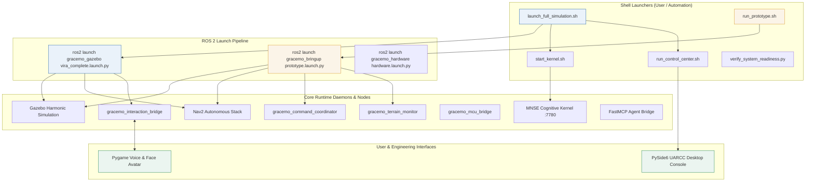

# GRaCEmo ViRa — Codebase Duplication and Redundancy Audit
# Document 06: Entry Points and Execution Map

**Audit Date:** November 2026  
**System:** GRaCEmo ViRa — Autonomous Robotics System  
**Objective:** Comprehensive mapping of all executable entry points, launch scripts, ROS node executables, and concurrent execution hazard analysis.

---

## 1. System Execution Architecture Map

---

## 2. Complete Entry Point Inventory

### 2.1 Top-Level Launchers & Orchestration Scripts

| Entry Point | Path | Role & Launched Processes | Runtime Target | Conflicting Entry Point |
| :--- | :--- | :--- | :--- | :--- |
| **Full Simulation Launcher** | `scripts/launch_full_simulation.sh` | Launches Distrobox container, Gazebo Harmonic, Nav2 stack, interaction bridge, MNSE kernel, and UARCC dashboard. | Ubuntu / Distrobox | Confuses environment if `run_prototype.sh` is already running. |
| **Prototype Launcher** | `scripts/run_prototype.sh` | Launches Gazebo apartment world, Nav2 navigation stack, command coordinator node, and interaction node in background. | Local Linux / Distrobox | Competes directly with `launch_full_simulation.sh`. |
| **UARCC Dashboard Launcher** | `scripts/run_control_center.sh` | Activates PySide6 virtual environment and executes `gracemo_control_center/main.py`. | Desktop Workstation | None (Client monitor). |
| **Clean Shutdown Script** | `scripts/stop_prototype.sh` | Scans for and terminates `gz sim`, `ros2`, `nav2`, `coordinator`, and Python bridge processes via SIGTERM/SIGKILL. | Local Linux | None (Cleanup utility). |
| **UARCC Stopper** | `scripts/stop_control_center.sh` | Terminates running `gracemo_control_center` and `unified_control_center` processes. | Local Linux | None. |
| **Kernel Launcher** | `scripts/start_kernel.sh` | Compiles and executes `kernel/gracemo-kernel` binary on port 7780 with socket `/tmp/gracemo.sock`. | Background Daemon | None. |
| **System Readiness Probe** | `scripts/verify_system_readiness.py` | Standalone Python script initializing temporary ROS 2 node `system_readiness_probe` to audit 12 subsystems. | CI / Verification | None (Exits cleanly after audit). |

### 2.2 ROS 2 Launch Files

| Launch File | Package Origin | Nodes & Included Launches | Hazard / Duplication Analysis |
| :--- | :--- | :--- | :--- |
| `vira_complete.launch.py` | `gracemo_gazebo` | Includes `sim.launch.py`, `nav2.launch.py`; launches `gracemo_interaction_bridge`. | Primary workspace launch. Omits autonomous `coordinator_node.py`. |
| `prototype.launch.py` | `gracemo_bringup` (prototype) | Includes `simulation.launch.py`, `navigation.launch.py`; launches `coordinator_node` and `interaction_node`. | Primary prototype launch. Has conflicting package names. |
| `sim.launch.py` | `gracemo_gazebo` | Launches Gazebo Harmonic, robot state publisher, and `ros_gz_bridge`. | Primary simulation launch. |
| `simulation.launch.py` | `gracemo_simulation` (prototype) | Launches Gazebo Harmonic with duplicate apartment world. | Duplicate of `sim.launch.py`. |
| `nav2.launch.py` | `gracemo_nav2` | Launches Nav2 bringup, AMCL, costmaps, and collision monitor with `radius: 0.22m`. | Primary navigation launch. |
| `navigation.launch.py` | `gracemo_navigation` (prototype) | Launches Nav2 bringup, AMCL, and costmaps with `radius: 0.23m`. | Duplicate of `nav2.launch.py`. |
| `hardware.launch.py` | `gracemo_hardware` | Launches `gracemo_mcu_bridge`, `gracemo_hardware_status`, and LiDAR drivers. | Physical hardware bringup (identical in both trees). |
| `display.launch.py` | `gracemo_description` | Launches RViz2 and joint state publisher GUI for visual inspection. | Visualization utility. |

### 2.3 User Interface Entry Points

| User Interface | Entry Point Script | Framework | Role & Concurrency Policy |
| :--- | :--- | :--- | :--- |
| **UARCC Engineering Console** | `gracemo_control_center/main.py` | PySide6 (Qt) | Engineering workstation dashboard for monitoring robot health, sensors, maps, logs, and manual goal dispatch. Multiple instances allowed as passive ROS clients. |
| **VIRA Social Interaction Engine** | `vira_interaction/main.py` / `model.py` | Pygame | Front-facing interactive face with speech recognition (Whisper) and speech synthesis (`pyttsx3`). **Only ONE instance allowed** to avoid soundcard device lockup. |

### 2.4 Standalone Exploration and Utility Entry Points

| Script | Path | Entry Command | Architectural Role & Safety Status |
| :--- | :--- | :--- | :--- |
| `auto_explore.py` | `scripts/auto_explore.py` | `python3 auto_explore.py` | **UNSAFE:** Directly commands `/cmd_vel` using raw LiDAR ranges without obstacle costmaps. |
| `closed_loop_nav.py` | `scripts/closed_loop_nav.py` | `python3 closed_loop_nav.py` | **UNSAFE:** Bypasses Nav2 to drive directly between coordinates. |
| `smart_explore.py` | `scripts/smart_explore.py` | `python3 smart_explore.py` | **UNSAFE:** Ad-hoc room explorer commanding motor velocity directly. |
| `mission_control.py` | `scripts/mission_control.py` | `python3 mission_control.py` | Dispatches Nav2 action goals with custom direct-drive timeout fallbacks. |
| `demo_model_reasoning.py` | `scripts/demo_model_reasoning.py` | `python3 demo_model_reasoning.py` | Offline benchmark script testing MNSE reasoning graphs. |

---

## 3. Concurrent Execution Hazards & Process Conflicts

| Conflict Scenario | Involved Processes | Root Cause & Failure Mode | Risk Level |
| :--- | :--- | :--- | :---: |
| **Dual Simulator Execution** | `launch_full_simulation.sh` + `run_prototype.sh` | Two instances of `gz sim` bind to default Gz transport port `11345`. Physics simulation locks up or terminates with `Address already in use`. | **CRITICAL** |
| **Dual Audio Capture** | `vira_interaction/main.py` + `adapters/voice/` | ALSA / PulseAudio device lockup. Second process crashes with `OSError: [Errno -9996] Invalid input device`. | **HIGH** |
| **Dual Nav2 Stack** | `nav2.launch.py` + `navigation.launch.py` | Two sets of AMCL particle filters and costmaps publish conflicting transforms to `/tf`, causing violent localization divergence in RViz2 and UARCC. | **CRITICAL** |
| **Rogue Velocity Injection** | Standalone `auto_explore.py` + Nav2 `controller_server` | Competing nodes publish conflicting velocities to `/cmd_vel` at different frequencies ($10\text{ Hz}$ vs $20\text{ Hz}$). Causes wheel chattering. | **CRITICAL** |
| **Kernel Port Collision** | Multiple `start_kernel.sh` invocations | Second kernel instance fails binding to TCP port 7780 (`EADDRINUSE`). | **MEDIUM** |
