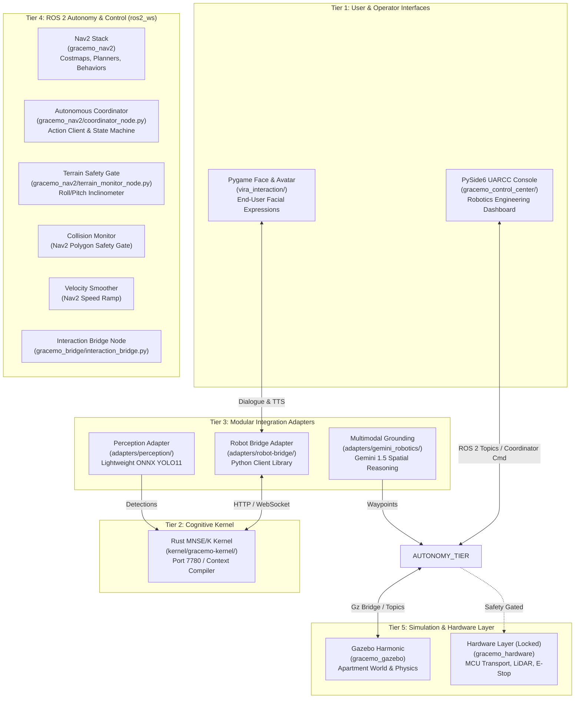
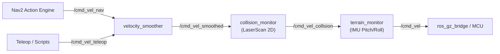

# GRaCEmo ViRa — Canonical Architecture Specification
# Document 12: Unified Authoritative System Architecture

**Consolidation Date:** November 2026  
**System:** GRaCEmo ViRa — Autonomous Robotics System  
**Status:** Canonical Reference Specification  
**Enforcement:** Mandatory for all runtime nodes, packages, and launch pipelines.

---

## 1. System Boundary Architecture

The GRaCEmo ViRa system enforces strict separation of concerns across five primary architectural tiers:

---

## 2. Authoritative ROS 2 Package Registry

All ROS 2 capabilities are consolidated into exactly five canonical packages located in `ros2_ws/src/`. All prototype and staging packages are retired:

| Canonical Package | Location | Primary Responsibilities | Retired / Superseded Duplicates |
| :--- | :--- | :--- | :--- |
| **`gracemo_nav2`** | `ros2_ws/src/gracemo_nav2/` | Navigation parameters, costmaps, Nav2 bringup, Autonomous Coordinator (`coordinator_node.py`), Terrain Monitor (`terrain_monitor_node.py`), Frontier Explorer (`frontier_explorer.py`). | `gracemo_navigation`, `gracemo_command_coordinator`, prototype `nav2_params.yaml`. |
| **`gracemo_description`** | `ros2_ws/src/gracemo_description/` | Complete URDF/Xacro kinematic chain, 15 high-fidelity CAD visual & collision meshes, Gazebo plugins, sensor frames. | `gracemo_robot_description`, `staging_blender_integration/meshes/`, `backup_pre_blender_integration/`. |
| **`gracemo_gazebo`** | `ros2_ws/src/gracemo_gazebo/` | Gazebo Harmonic apartment simulation world (`gracemo_apartment.world`), complete multi-node launch pipeline (`vira_complete.launch.py`), ROS-Gz message bridge. | `gracemo_simulation`, duplicate SDF worlds. |
| **`gracemo_hardware`** | `ros2_ws/src/gracemo_hardware/` | Serial MCU transport, framed protocol, LiDAR driver, hardware status diagnostics node, fail-closed safety clamps (`MOTOR_OUTPUT_ENABLED = 0`). | Prototype `gracemo_hardware` copies. |
| **`gracemo_bridge`** | `ros2_ws/src/gracemo_bridge/` | ROS 2 Interaction Bridge node (`interaction_bridge.py`), kernel telemetry streaming, ROS-to-Cognitive bridging. | Duplicate copies in `adapters/robot-bridge/`. |

---

## 3. Authoritative Command Pipeline

To guarantee collision avoidance, terrain slope protection, and velocity acceleration limits, motion commands must pass through exactly one authoritative pipeline:

### Absolute Autonomy Invariants:
1. **Single Autonomous Coordinator:** `coordinator_node.py` (in `gracemo_nav2`) is the sole entity authorized to dispatch autonomous Nav2 goals and report mission state.
2. **No Direct Motor Injection:** Standalone scripts and operator GUIs must publish to `/cmd_vel_teleop` or use Nav2 action goals. Publishing directly to raw `/cmd_vel` is prohibited.
3. **Safety Watchdog Precedence:** An active E-Stop assertion in `terrain_monitor` or `hardware_status` zeroes all velocity and overrides all active goals immediately.
