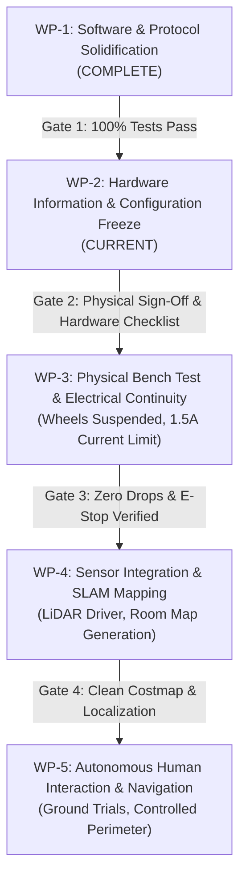

# GRaCEmo ViRa — Gap Closure & Staged Implementation Roadmap

**Date:** 2026-10-28  
**Author:** Principal Robotics Systems Engineer (Antigravity)  
**System:** GRaCEmo ViRa Autonomous Mobile Robot Platform  
**Target Hardware:** NVIDIA Jetson Orin Nano ↔ STMicroelectronics STM32F746ZG  

---

## 1. Roadmap Architecture & Staging Strategy

To guarantee strict adherence to safety standards, gap closure is partitioned into five phased work packages (WP-1 through WP-5). Progression between packages requires fulfilling hard gate acceptance criteria. Under no circumstances may motor power be applied until WP-3 bench validation passes with wheels suspended.

---

## 2. Work Package Breakdown

### Work Package 1: Software Architecture & Protocol Solidification (Status: COMPLETE)
- **Objective:** Establish compilable, testable, and fail-closed software abstractions on Jetson and STM32.
- **Tasks Completed:**
  - Integrated `gracemo_hardware` into `ros2_ws/src/` and verified with `colcon build`.
  - Implemented `mcu_protocol.py` (Python serializer/deserializer with XOR checksums).
  - Enhanced `SerialMCUTransport` in `mcu_transport.py` with bounded streaming buffer (`feed_bytes`), split/concatenated frame parsing, and 1.5s telemetry freshness watchdog.
  - Implemented `camera_driver.py` and `audio_driver.py` with `VoiceCommandParser` (absolute STOP priority) and integration tests.
  - Implemented `gracemo_vira_parameterized.urdf.xacro` supporting both 2WD differential and 4WD skid-steer topologies.
  - Validated STM32 firmware compilation against `STMicroelectronics:stm32:Nucleo_144:pnum=NUCLEO_F746ZG`.
  - Fixed `Serial1` link error by configuring `ROBOT_LINK` as `Serial` for ST-LINK VCP.
  - Implemented 8-state `HumanInteractionBehaviorManager` with stationary 60-second observation timer, wake consent, and sub-50ms stop priority.
  - Connected EventBus perception stream (`PersonVisible`) to behavior manager.
  - Executed 198 automated tests in migration workspace (155 in unit/hardware/ros2 + 35 in safety/fault/contract + 8 in URDF) and 47 tests in prototype workspace (245 total) with 100% pass rate.
- **Acceptance Gate 1:** PASSED. All unit, hardware interface, safety, and ROS 2 bridge tests pass in simulation/mock mode.

---

### Work Package 2: Hardware Information & Configuration Freeze (Status: CURRENT)
- **Objective:** Eliminate configuration discrepancies through direct physical inspection and establish the hardware freeze.
- **Tasks:**
  1. **Physical Caliper Measurement:** Measure center-to-center wheel distance on the real chassis to definitively settle $0.34\text{ m}$ (URDF) vs $0.32\text{ m}$ (`config/robot.yaml`).
  2. **Drive Topology Confirmation:** Inspect physical motor layout to verify whether all 4 wheels are driven or if 2 driven wheels pair with front/rear passive casters.
  3. **Motor Driver Identification:** Identify exact controller model (e.g. Roboteq dual-channel CAN, Copley Controls, or PWM H-bridge) and protocol specifications.
  4. **Encoder CPR & Pinout Verification:** Confirm optical/magnetic quadrature encoder counts per revolution (CPR = 2048 nominal) and STM32 timer channels.
  5. **Battery Chemistry & Monitor:** Confirm nominal bus voltage ($12\text{ V}$ vs $24\text{ V}$) and I2C address of TI INA228 power monitor.
- **Prerequisites:** Physical access to the robot chassis and electrical schematics.
- **Acceptance Gate 2:** Completed and signed `docs/hardware_verification_checklist.md`. Configuration files updated and frozen.

---

### Work Package 3: Physical Bench Test & Electrical Continuity (Status: PENDING WP-2)
- **Objective:** Verify serial communication, watchdog timeouts, and emergency-stop circuits on real hardware with zero motion risk.
- **Safety Invariant:** Robot chassis MUST be elevated on a bench stand with all wheels suspended freely in the air. Motor power supply current-limited to $\le 1.5\text{ A}$.
- **Tasks:**
  1. **Dry Serial Communication:** Connect Jetson Orin Nano to STM32 via USB-UART (`/dev/ttyUSB0` or `/dev/ttyACM0`). Transmit 10,000 `HEARTBEAT` frames at 20 Hz; verify 0 dropped packets and 0 parse errors.
  2. **Watchdog Verification:** Intentionally silence `/cmd_vel` stream; verify firmware enters `SAFE_STOP` within $500\text{ ms}$. Disconnect UART cable; verify Jetson bridge detects stale telemetry within $1500\text{ ms}$.
  3. **Hardwired E-Stop Continuity:** Press physical red emergency-stop mushroom button. Measure contactor coil voltage to confirm immediate drop to 0.0V. Confirm active-low feedback `MOTOR_PWR_ON_N` asserts `estop_bit = 1` in telemetry.
  4. **Controlled Low-Speed Spin:** With wheels suspended, authorize `HARDWARE_TEST` mode ($0.05\text{ m/s}$). Verify wheel rotation sense (+ forward) and encoder tick accumulation symmetry.
- **Acceptance Gate 3:** Successful 1-hour dry soak test with zero communication errors, verified physical E-stop cut, and symmetrical encoder feedback.

---

### Work Package 4: Sensor Integration & SLAM Mapping (Status: PENDING WP-3)
- **Objective:** Deploy physical LiDAR and camera drivers, generate physical environment map, and calibrate localization.
- **Tasks:**
  1. **LiDAR Driver Deployment:** Install verified vendor package (`sllidar_ros2` for RPLiDAR or `ydlidar_ros2_driver`) in `ros2_ws/src/`. Validate `/scan` topic at 15 Hz.
  2. **Camera Driver Deployment:** Configure V4L2 / CSI camera pipeline on Jetson Orin Nano. Validate `/camera/image_raw` at 30 fps.
  3. **SLAM Toolbox Mapping:** Teleoperate robot manually across physical facility to build authoritative occupancy grid map (`physical_office_map.yaml`).
  4. **AMCL Localization Calibration:** Tune particle filter spread and verify laser scan alignment against map.
- **Acceptance Gate 4:** AMCL localization convergence with $< 5\text{ cm}$ position error and $< 2^\circ$ orientation error.

---

### Work Package 5: Autonomous Human Interaction & Navigation (Status: PENDING WP-4)
- **Objective:** Closed-loop validation of voice navigation, person detection, stationary observation, and person following in a controlled physical enclosure.
- **Safety Invariant:** Safety perimeter marked; test operator holds physical E-stop pendant at all times.
- **Tasks:**
  1. **Verbal Stop Validation:** Drive robot at $0.20\text{ m/s}$; issue voice "STOP"; verify absolute wheel stop within $100\text{ ms}$.
  2. **Person Detection & Observation Loop:** Person walks in front of robot; robot transitions to `OBSERVATION_60S` and remains stationary. Verify timer auto-expires to `IDLE` after 60 seconds if no wake word spoken.
  3. **Consent-Gated Interaction:** Speak wake phrase "Hello GraceEMO"; robot transitions to `INTERACTION`. Command "take me to the lab"; robot dispatches Nav2 goal and guides user.
  4. **Person Following & Target Loss:** Command "follow me"; robot follows at 1.5m standoff. Target steps behind barrier; verify robot safely halts within $500\text{ ms}$ upon tracking loss.
- **Acceptance Gate 5:** Production sign-off and final operational acceptance report.
