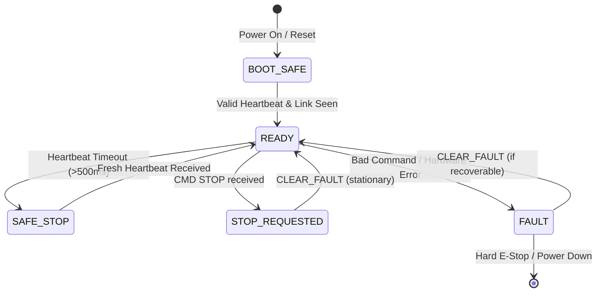

# STM32 ↔ NVIDIA Jetson Communication Protocol Specification
**Status:** PROPOSED — NOT APPROVED (Draft v1.0)  
**Target Architecture:** NVIDIA Jetson Orin Nano (ROS 2 Jazzy) ↔ STMicroelectronics STM32F746ZG / NUCLEO-F746ZG  
**Safety Classification:** Level 1 Hardware Control Link (Motor outputs disabled by default)  
**Physical Link:** Dedicated 3.3 V CMOS UART (ST-LINK VCP or direct USART header), 115200 Baud, 8N1, Newline-delimited ASCII frames  

---

## 1. Executive Summary & Purpose

This specification establishes a robust, bounded, human-inspectable serial communication contract between the Jetson high-level autonomy stack (ROS 2 HAL bridge) and the STM32 low-level motion controller.

### Operational Guardrails
- **PROPOSED / NOT APPROVED:** Real serial transport in ROS 2 remains strictly blocked (`PROTOCOL_CONFIRMED=False`) until physical bench validation and human sign-off are complete.
- **MOTOR OUTPUTS INHIBITED:** All firmware builds enforce `MOTOR_OUTPUT_ENABLED = 0`. Actuation requests update internal command registers only and do not energize motor drivers or CAN actuation buses.
- **FAIL-CLOSED ARCHITECTURE:** Missing heartbeats, checksum errors, parameter violations, or communication drops immediately transition both Jetson and STM32 to `SAFE_STOP` / `FAULT`.

---

## 2. Physical & Data Link Layer

| Parameter | Specification | Notes |
|---|---|---|
| **Interface** | UART (Jetson 40-pin header or USB-CDC / ST-LINK VCP) | Default device path: `/dev/ttyUSB0` or `/dev/ttyACM0` |
| **Baud Rate** | 115200 bps | Slew-rate compatible with 3.3 V logic |
| **Frame Format** | 8 Data Bits, No Parity, 1 Stop Bit (8N1) | Standard asynchronous framing |
| **Line Termination** | `\r\n` or `\n` | Parser strips `\r` and triggers processing on `\n` |
| **Buffer Limit** | 96 bytes maximum per frame | Any line exceeding 95 chars without `\n` triggers `ERR,OVERFLOW` |
| **Integrity Check** | Optional trailing 8-bit XOR checksum (`*XX` hex) | Validates framing against transmission corruption |

---

## 3. Command Frames (Jetson → STM32)

All command frames follow the format:
```text
CMD,<seq_id>,<COMMAND_NAME>[,<arg1>,<arg2>,...][*<chk>]
```
- `<seq_id>`: Monotonically increasing 16-bit integer (0–65535) used for packet freshness tracking.
- `*<chk>`: Optional 2-digit uppercase hex XOR checksum of all characters between `C` and the preceding comma/arg.

### 3.1 Heartbeat (`HEARTBEAT`)
Maintains the communication watchdog alive. Sent at 10 Hz to 20 Hz from Jetson.
```text
CMD,101,HEARTBEAT
```
- **Firmware Response:** `ACK,101,HEARTBEAT`
- **Timeout:** If no heartbeat is received within `500 ms`, firmware enters `SAFE_STOP`.

### 3.2 Drive Command (`DRIVE`)
Transmits validated differential velocity requests.
```text
CMD,102,DRIVE,<linear_mps>,<angular_rad_s>
```
- `<linear_mps>`: Commanded linear speed $[-0.35, +0.35]\text{ m/s}$.
- `<angular_rad_s>`: Commanded yaw rate $[-0.75, +0.75]\text{ rad/s}$.
- **Firmware Response:**
  - If safety conditions met: `ACK,102,DRIVE_ACCEPTED_OUTPUT_DISABLED`
  - If out of bounds: `ERR,102,DRIVE_RANGE` (raises `FAULT_BAD_COMMAND`)
  - If in safe stop / fault: `ERR,102,MOTION_INHIBITED`

### 3.3 Emergency Stop (`STOP`)
Immediate software emergency stop command. Highest priority.
```text
CMD,103,STOP
```
- **Firmware Response:** `ACK,103,STOP`
- **Action:** Clears target velocities to 0.0, drops motor enable, transitions state to `STOP_REQUESTED`.

### 3.4 Clear Recoverable Fault (`CLEAR_FAULT`)
Attempts to reset a recoverable fault (e.g., cleared watchdog or bad parameter).
```text
CMD,104,CLEAR_FAULT
```
- **Firmware Response:** `ACK,104,CLEAR_FAULT` or `ERR,104,CANNOT_CLEAR_WHILE_MOVING`
- **Condition:** Allowed only when wheels are stationary.

### 3.5 Query Status (`STATUS`)
Forces immediate telemetry output.
```text
CMD,105,STATUS
```
- **Firmware Response:** Standard `STATUS,...` line.

---

## 4. Telemetry Frames (STM32 → Jetson)

The STM32 periodically emits telemetry lines at 20 Hz (every 50 ms) or 10 Hz.

### 4.1 Periodic Telemetry (`TELEM`)
Carries full wheel feedback and dead-reckoning odometry for the ROS 2 `/odom` pipeline:
```text
TELEM,<seq>,<left_vel>,<right_vel>,<left_ticks>,<right_ticks>,<odom_x>,<odom_y>,<odom_yaw>,<battery_v>,<estop_bit>,<fault_code>
```
Example:
```text
TELEM,2045,0.120,0.125,1024,1030,0.450,0.120,0.052,12.45,0,0
```

| Field Index | Field Name | Data Type | Units / Range | Description |
|---|---|---|---|---|
| 1 | `seq` | uint16 | 0 – 65535 | Telemetry sequence counter |
| 2 | `left_vel` | float32 | m/s | Actual measured left wheel velocity |
| 3 | `right_vel` | float32 | m/s | Actual measured right wheel velocity |
| 4 | `left_ticks` | int32 | counts | Cumulative quadrature encoder ticks |
| 5 | `right_ticks`| int32 | counts | Cumulative quadrature encoder ticks |
| 6 | `odom_x` | float32 | meters | Integrated Cartesian X displacement |
| 7 | `odom_y` | float32 | meters | Integrated Cartesian Y displacement |
| 8 | `odom_yaw` | float32 | radians | Integrated Heading angle $[-\pi, +\pi]$ |
| 9 | `battery_v` | float32 | Volts | Measured battery voltage (nominal 12.4 V / 24.0 V) |
| 10 | `estop_bit` | uint8 | 0 or 1 | 1 = Physical E-stop button / contactor open |
| 11 | `fault_code`| uint8 | hex/enum | Active MCU fault code (0 = NONE) |

### 4.2 Status & Health Line (`STATUS`)
Periodic summary line (1 Hz):
```text
STATUS,fw=0.1.0,safety=READY,motor_output=disabled,link=seen,fault=NONE
```

### 4.3 Error Replies (`ERR`)
```text
ERR,<seq_or_0>,<ERROR_REASON>
```
Known reasons: `PARSE`, `OVERFLOW`, `CHECKSUM`, `MOTION_INHIBITED`, `DRIVE_RANGE`, `CANNOT_CLEAR_WHILE_MOVING`, `UNKNOWN_COMMAND`.

---

## 5. Safety Supervision & Watchdog Contracts



1. **Host-Side Watchdogs (`mcu_bridge_node.py`):**
   - Command Watchdog: If `/cmd_vel` is silent for $> 500\text{ ms}$, publish zero velocity.
   - Telemetry Watchdog: If no telemetry received for $> 1500\text{ ms}$, flag critical fault (`code=0x02`), zero velocities, and broadcast alarm.
2. **MCU-Side Watchdogs (`safety.h`):**
   - Command Watchdog: If no valid command/heartbeat received for $> 500\text{ ms}$, transition to `SAFE_STOP`, de-energize actuation.
3. **Hardwired Interlocks:**
   - Active-low optocoupled contactor feedback (`MOTOR_PWR_ON_N`) is wired to MCU GPIO.
   - Physical stop cuts motor bus power directly. Firmware telemetry propagates `estop_bit=1` to host.

---

## 6. Review & Approval Protocol

To advance this protocol from `PROPOSED` to `APPROVED`:
1. **Verification of Serial Enumeration:** Confirm persistent udev rules on Jetson Orin Nano for `/dev/ttyUSB0` (or ST-LINK `/dev/ttyACM0`).
2. **Hardware Bench Verification:** Connect Jetson and STM32 with motor power completely disconnected. Verify clean transmission of 10,000 frames with 0 packet drops or parse errors.
3. **Sign-off:** Lead Systems Engineer and Embedded Software Engineer must review and sign.
4. **Activation:** Only upon approval may `SerialMCUTransport.PROTOCOL_CONFIRMED` be toggled to `True`.
